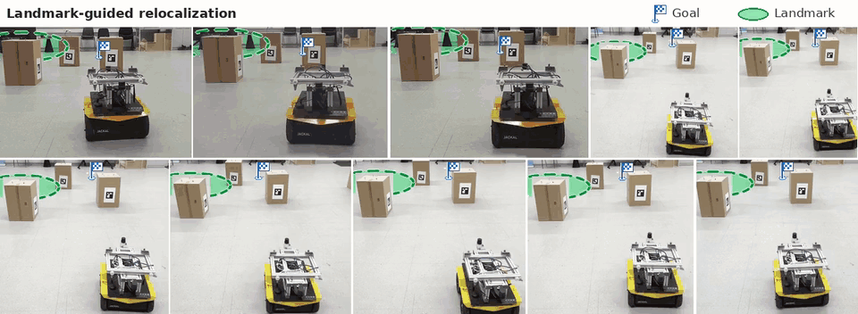

# When to Seek Landmarks? Learning Continuous Control with Sparse Landmark Localization

**Chinmay Mundane · Amith Manoharan · Arun Kumar Singh**  
University of Tartu, Estonia

[GitHub](https://github.com/ChinmayMundane/LocRL)

## Overview

Robots navigating with onboard odometry accumulate localization error. Sparse landmarks can provide corrective measurements, but reaching them may require a detour. **LocRL** studies when a robot should seek a landmark and when it should continue toward its goal.

We formulate navigation as a continuous-control partially observable Markov decision process (POMDP). A belief-aware Soft Actor–Critic (SAC) policy uses local semantic observations and extended Kalman filter (EKF) features to balance goal progress and localization uncertainty. We also study preference-conditioned multi-objective reinforcement learning with CAPQL and PC-SAC to trade off navigation and localization objectives.

## Highlights

- **Simulation:** Balanced fixed-weight SAC achieves 96.6% success across five seeds and 200 unseen maps, compared with 89.5%–91.8% for the evaluated RRT* planning baselines.
- **Uncertainty:** Covariance area under the curve is 55.2% lower than Dubins RRT*; success remains 92.7% on hard maps.
- **Preference-conditioned control:** CAPQL achieves lower mean position error than PC-SAC at all three evaluated preferences.
- **Hardware:** Experiments on a Clearpath Jackal demonstrate navigation with landmark-restricted pose corrections and EKF belief tracking.

## Repository status

This repository currently contains the project overview and teaser. Training and evaluation code are not included yet.
